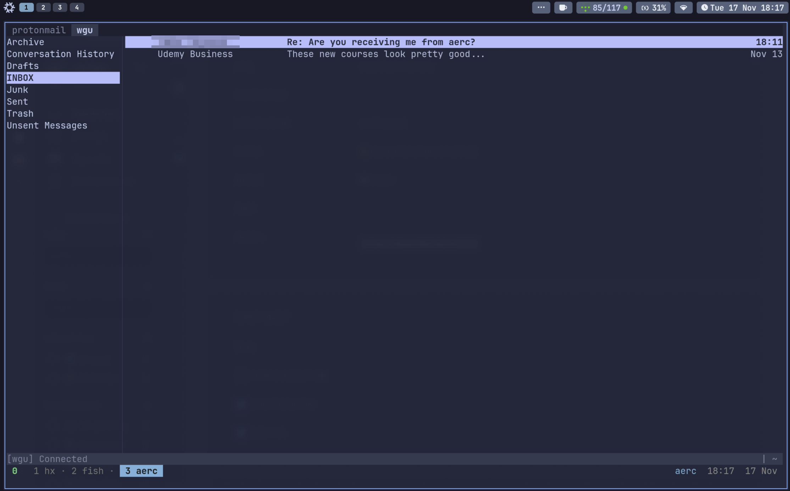

I'm a student at WGU. WGU uses Microsoft 365 for their email backend. I don't mind the Outlook client on mobile, but I much prefer a TUI-based email client, like `aerc`, when I'm at a computer.

So, I set up Davmail to allow me to access Outlook via IMAP/SMTP endpoints while still using OAuth.



# Davmail Configuration (`davmail.properties`)

> Note: the `davmail.oauth.clientId` below is Outlook's client ID.

```
davmail.url=https://outlook.office365.com/EWS/Exchange.asmx
davmail.mode=O365Interactive
davmail.server=true
davmail.allowRemote=true
davmail.oauth.clientId=d3590ed6-52b3-4102-aeff-aad2292ab01c
davmail.oauth.redirectUri=https://login.microsoftonline.com/common/oauth2/nativeclient
davmail.oauth.scope=openid profile offline_access https://outlook.office365.com/EWS.AccessAsUser.All
davmail.imapPort=1143
davmail.smtpPort=1025
davmail.caldavPort=1080
davmail.popPort=1110
davmail.ldapPort=1389
davmail.disableUpdateCheck=true
davmail.logFilePath=/var/log/davmail.log
```

I run Davmail in my Kubernetes cluster using my own Davmail image: [hub.docker.com/r/heywoodlh/davmail](https://hub.docker.com/r/heywoodlh/davmail)

# Aerc Configuration

Since I use [aerc](https://aerc-mail.org/) as my email client, here's my general aerc configuration, with values specific to my setup renamed as `CHANGEME`:

```
[wgu]
copy-to = Sent
default = INBOX
from = FIRSTNAME LASTNAME <CHANGEME@wgu.edu>
outgoing = smtp+insecure://CHANGEME%40wgu.edu@CHANGEME:25
outgoing-cred-cmd = CHANGEME
source = imap+insecure://CHANGEME%40wgu.edu@CHANGEME:143
source-cred-cmd = CHANGEME
```

# Initial Setup with My Container

> If you aren't using my container and are running Davmail on your own setup, start your configured email client and use the URL that your Davmail instance provides.

After Davmail is running and aerc (or your preferred IMAP/SMTP client) is configured, open the email client. This should trigger Davmail to attempt authentication. Access the KasmVNC port for the container — there should be an Office 365 login URL with a "Copy to Clipboard" button. KasmVNC has a sidebar for clipboard management: copy the URL out of the sidebar and log in. After authenticating, you'll see a page that says something like "this page has your password, phishers will use it." Copy that URL and paste it back into the KasmVNC session using the clipboard manager sidebar, then press Ctrl+V in the Davmail window.

Once initial authentication is complete, you shouldn't need to repeat the OAuth flow.
